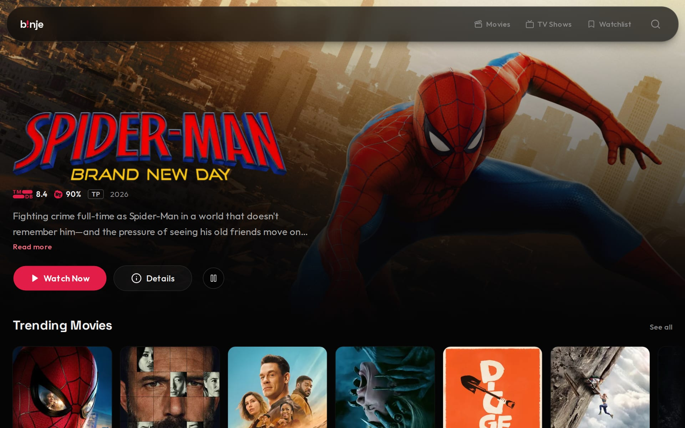
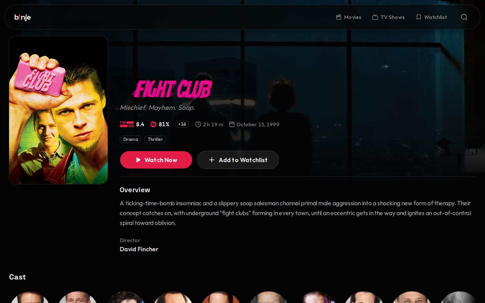
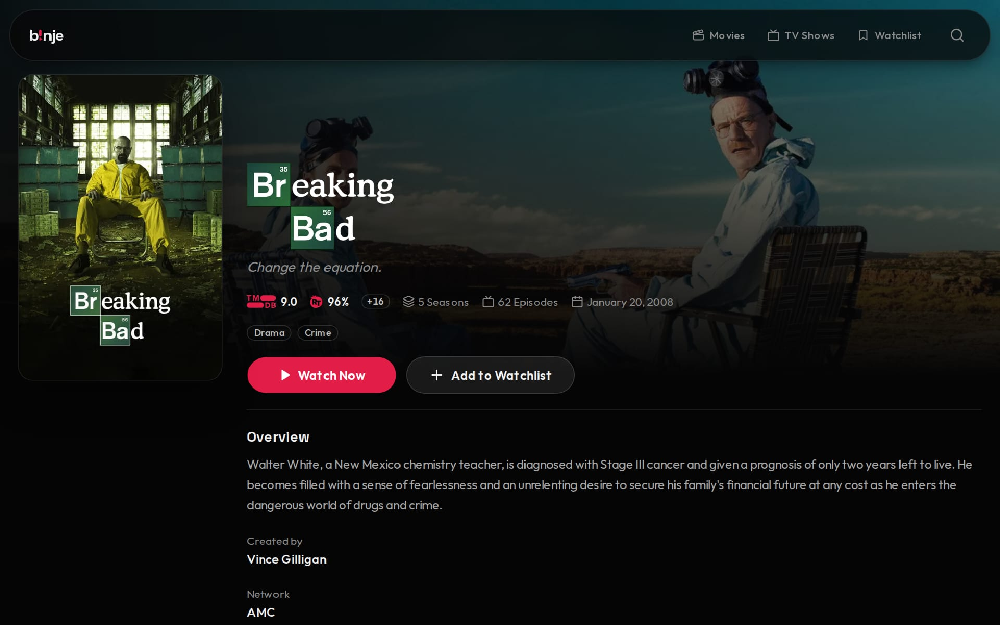
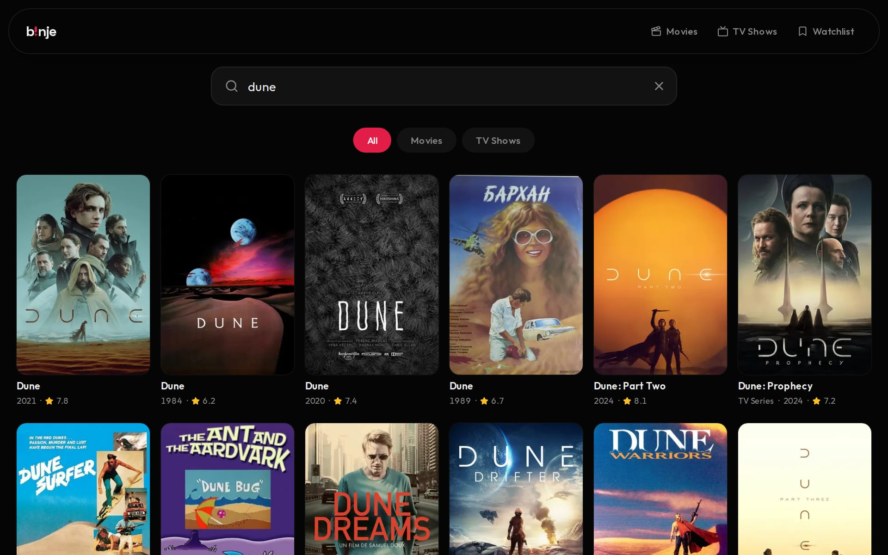
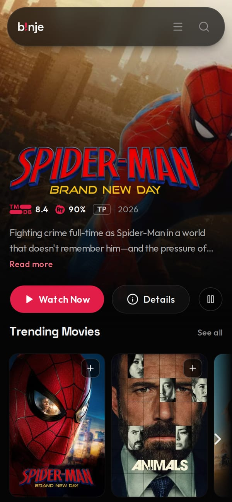
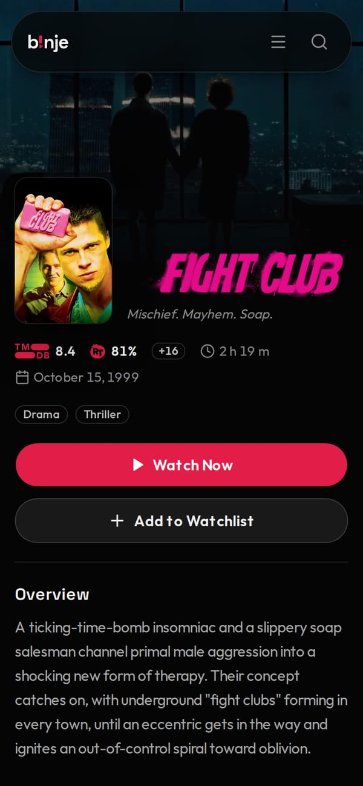
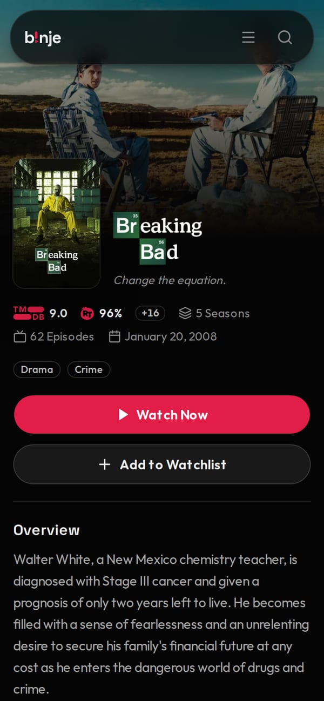
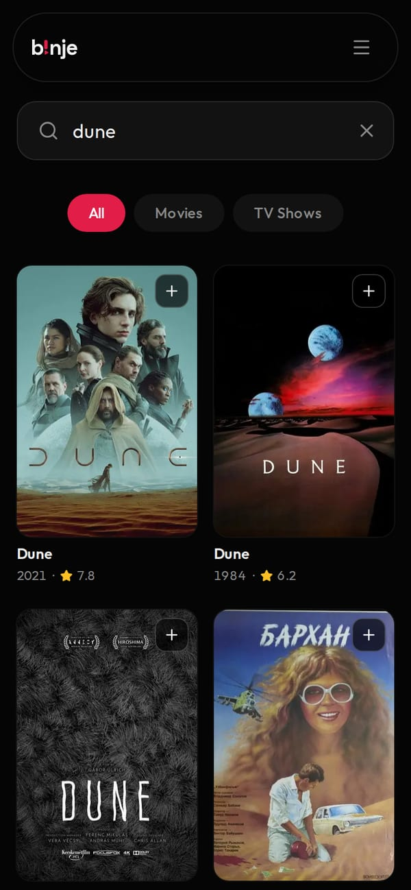

<p align="center">
  
</p>

<h1 align="center">b!nje</h1>

<p align="center">A movie and TV discovery app for web, Android, and iOS.</p>

<p align="center">
  <a href="https://nextjs.org"></a>
  <a href="https://bun.sh"></a>
  <a href="https://tailwindcss.com"></a>
  <a href="https://expo.dev"></a>
  <a href="https://github.com/kacigaya/binje/blob/main/LICENSE"></a>
</p>

## Features

- Browse, search, and filter movies and TV shows (data from TMDB).
- Watch in a custom HLS player with subtitles, quality select, and auto-sync.
- Cast with Google Cast and AirPlay.
- English and French interfaces.
- Expo mobile app for Android and iOS.

## Screenshots

### Desktop



Home: auto-rotating hero with title logo, TMDB and Rotten Tomatoes scores, certification, and a pause control, followed by trending carousels.



Movie detail: poster, title logo, TMDB and Rotten Tomatoes scores, certification, runtime, release date, watchlist button.



TV detail: season and episode counts alongside the same ratings, certification, and first air date.



Search: fuzzy, year-aware results with All / Movies / TV Shows filters.

### Mobile web

| Home | Movie | TV | Search |
| --- | --- | --- | --- |
|  |  |  |  |

Posters, backdrops, and logos in these screenshots come from TMDB.

## Setup

1. Install [Bun](https://bun.sh).
2. Create `.env.local`:

   ```bash
   TMDB_API_KEY=your_key
   OMDB_API_KEY=your_key        # optional: Rotten Tomatoes scores
   STREAM_PROXY_URL=http://...  # optional: VPN proxy for Atlantic streams
   ```

3. Install and run:

   ```bash
   bun install
   bun dev
   ```

4. Open <http://localhost:3000>.

Subtitle auto-sync needs `ffmpeg` on the server. The Docker image includes it.

## Mobile

```bash
cp apps/mobile/.env.example apps/mobile/.env
bun run mobile:start
```

See [`apps/mobile/README.md`](./apps/mobile/README.md).

## Privacy

Watch history stays in your browser's `localStorage`. No tracking and no analytics.

## License

MIT
